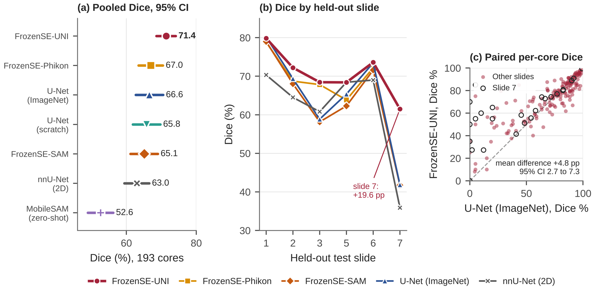

# FrozenSE

**A parameter-efficient adaptation framework for frozen foundation encoders in prostate cancer histopathology segmentation.**

FrozenSE turns a pretrained foundation encoder into a prompt-free tumour segmenter while keeping most of it frozen. Only the last encoder blocks are fine-tuned, and a 1.44 M-parameter decoder with squeeze-and-excitation (SE) blocks and two skip connections is trained. The same decoder and training protocol work with three encoders:

| Model | Encoder | Pretraining | Total / trainable parameters |
|---|---|---|---|
| **FrozenSE-SAM** | MobileSAM TinyViT | Distilled from SAM (natural images) | 7.19 M / 4.59 M |
| **FrozenSE-Phikon** | Phikon ViT-B/16 | iBOT on histology tiles | 87.85 M / 16.23 M |
| **FrozenSE-UNI** | UNI ViT-L/16 | DINOv2 on histology tiles | 305.52 M / 27.37 M |



## Results

Leave-one-slide-out cross-validation on the 193 labelled cores of the [Gleason 2019 Challenge](https://gleason2019.grand-challenge.org/) (six slides). Every model trains on 35 annotated cores per fold; a separate validation slide drives all model selection; every core is tested exactly once, on a slide the model has never seen.

| Model | Dice (%) [95% CI] | IoU (%) | HD95 (µm) | Dice SD across slides |
|---|---|---|---|---|
| **FrozenSE-UNI** | **71.4** [68.6, 74.1] | 66.8 | 16.6 | 6.2 |
| FrozenSE-Phikon | 67.0 [63.5, 70.5] | 62.3 | 18.4 | 12.7 |
| U-Net, ImageNet ResNet-34 | 66.6 [62.7, 70.5] | 62.7 | 21.4 | 13.4 |
| U-Net, from scratch | 65.8 [61.8, 69.7] | 61.9 | 22.2 | 13.1 |
| FrozenSE-SAM | 65.1 [61.2, 69.0] | 61.0 | 22.2 | 12.9 |
| nnU-Net v2 (2D) | 63.0 [59.4, 66.5] | 58.9 | 21.2 | 13.0 |
| MobileSAM, zero-shot | 52.6 [49.0, 56.2] | 48.3 | 42.0 | 12.1 |

- **FrozenSE-UNI** exceeds the pretrained U-Net by 4.8 points (95% CI 2.7 to 7.3) and nnU-Net by 8.4 points, while training 9% of its parameters.
- On the hardest held-out slide it scores 61.5%, where every other model scores 36% to 42%.
- It leaves 51% of tumour-free patches correctly empty, against 28% for the pretrained U-Net.
- **FrozenSE-SAM**, the smallest model, comes within 1.5 points of the pretrained U-Net with 5.3 times fewer trainable parameters.
- With **5 annotated cores** instead of 35, FrozenSE-SAM keeps 98.7% of its accuracy (three independent draws).

### What FrozenSE adds to the encoder

Removing either component of the framework from FrozenSE-UNI, on all six folds:

| UNI configuration | Trainable params | Dice (%) [95% CI] | Slide 7 Dice (%) | Tumour-free patches left empty |
|---|---|---|---|---|
| **FrozenSE-UNI** (SE decoder + last two blocks fine-tuned) | 27.4 M | **71.4** [68.6, 74.1] | **61.5** | **51.3%** |
| Linear head instead of the FrozenSE decoder | 25.2 M | 67.2 [63.7, 70.7] | 41.8 | 34.6% |
| FrozenSE decoder, encoder fully frozen | 2.2 M | 67.2 [63.5, 70.9] | 42.4 | 35.4% |

Each reduced model loses 4.2 Dice points (Holm-adjusted p < 0.001 and p = 0.002) and falls to the level of the pretrained U-Net, including on the hardest slide. The encoder alone does not give the advantage; the framework does.

Every number above can be recomputed from the saved per-patch results in this repository (see [Recompute the tables and figures](#recompute-the-tables-and-figures)).

## Repository layout

```
frozense/      the Python package: models, data, training, metrics, cross-validation
notebooks/     the two notebooks that ran every experiment (Kaggle or Colab)
analysis/      scripts that rebuild the result tables and figures from saved runs
results/       per-patch results of every fold, result tables, fold manifests
figures/       the paper's figures (PDF and 600 dpi PNG)
tests/         checks of the split, consensus labels, resuming and aggregation
scripts/       helper to package the code for Kaggle
docs/          step-by-step reproduction guide and method notes
```

## Quick start

### 1. Recompute the tables and figures

No GPU and no dataset are needed. This rebuilds every result table and figure from the saved runs.

```bash
git clone https://github.com/michealidedia/FrozenSE.git
cd FrozenSE
pip install numpy scipy matplotlib pillow
unzip -q results/raw_runs.zip -d runs
python analysis/compute_statistics.py runs results/tables
python analysis/make_figures.py runs figures
```

### 2. Use a model in your own code

```python
import torch
from frozense.config import ModelConfig
from frozense.models import build_model

cfg = ModelConfig(arch="pfm_phikon",            # or "pfm_uni", "frozense_sam"
                  use_skip_connections=True,
                  unfreeze_last_n_blocks=2)     # 1 for "frozense_sam"
model = build_model(cfg, target_size=512)

x = torch.randn(1, 3, 512, 512)                 # ImageNet-normalised H&E patch
logits, _ = model(x)                            # (1, 1, 512, 512)
mask = torch.sigmoid(logits) > 0.5
```

- `pfm_phikon` downloads Phikon from Hugging Face (public).
- `pfm_uni` needs approved access to [MahmoodLab/UNI](https://huggingface.co/MahmoodLab/UNI) and the `HF_TOKEN` environment variable.
- `frozense_sam` needs the official `mobile_sam.pt` weights; set `sam_checkpoint` in `ModelConfig` to their path.

### 3. Retrain everything

The experiments were run on Kaggle with two T4 GPUs. [docs/REPRODUCE.md](docs/REPRODUCE.md) gives the steps, inputs, settings and expected run times.

## Installation

```bash
pip install -r requirements.txt
pip install git+https://github.com/ChaoningZhang/MobileSAM.git   # for FrozenSE-SAM and zero-shot MobileSAM
```

The versions in `requirements.txt` are the ones the reported runs used (Python 3.13, PyTorch 2.11).

## Tests

```bash
for t in tests/test_*.py; do python "$t"; done
```

The tests need no GPU and no dataset. To run the whole pipeline (every architecture, ablation and loss, cross-validation with resume, tables) on a small synthetic dataset on the CPU:

```bash
python tests/e2e_cpu_smoke.py path/to/mobile_sam.pt
```

## Data

The Gleason 2019 data are distributed by the challenge organisers and are not included here. The study uses the 193 cores that carry consensus labels (folders `imagesTr`, `imagesVal`, `Generated_Labels_Train`, `labelsVal`) and the per-pathologist maps (`annotations/Map1` to `Map6`). `results/fold_manifests/` lists the cores in every partition of every fold.

## Citation

If you use this code or these results, please cite:

```bibtex
@article{emmanuel_frozense,
  title   = {FrozenSE: A parameter-efficient adaptation framework for frozen foundation encoders in prostate cancer histopathology segmentation},
  author  = {Emmanuel, Jerry and Anthony, Micheal and Oyelade, Jelili},
  note    = {Manuscript under review},
  year    = {2026}
}
```

## Acknowledgements

This work builds on [MobileSAM](https://github.com/ChaoningZhang/MobileSAM), [Phikon](https://huggingface.co/owkin/phikon), [UNI](https://huggingface.co/MahmoodLab/UNI), [nnU-Net](https://github.com/MIC-DKFZ/nnUNet) and [segmentation_models.pytorch](https://github.com/qubvel-org/segmentation_models.pytorch). Each encoder is subject to its own licence; UNI in particular is released for non-commercial academic research.

The research was funded by the World Bank through the Covenant Applied Informatics and Communication African Centre of Excellence (CApIC-ACE), Covenant University.

## Licence

The code in this repository is released under the [MIT Licence](LICENSE).
